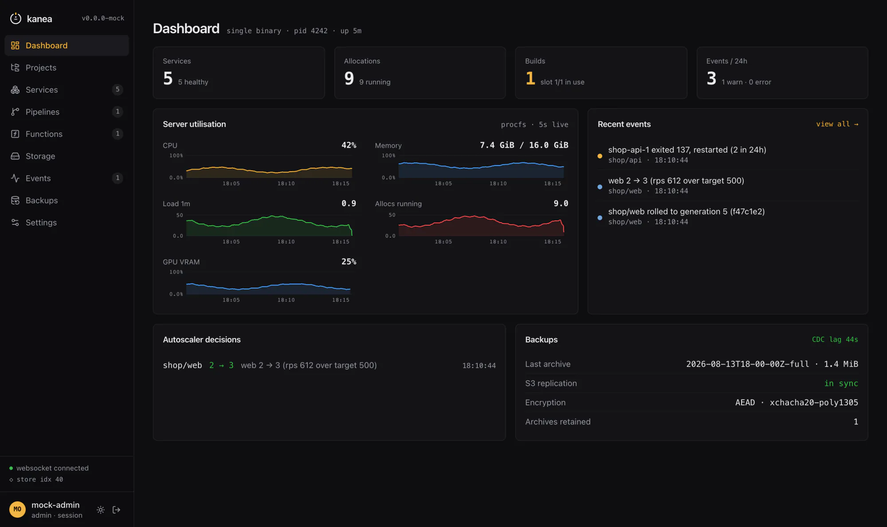

<div align="center">

<h1 align="center">
  <picture>
    <source media="(prefers-color-scheme: dark)" srcset="./logo/kanea-mark-dark.svg">
    
  </picture>
  &nbsp;Kanea
</h1>

<p align="center"><strong>Container orchestration in one binary.</strong></p>



Kanea runs your containers on a Linux machine you own, from one Go binary.
You describe services in an HCL spec; Kanea runs them on containerd, connects them with its own eBPF network and serves them over HTTPS.
The same binary carries the dashboard, build pipelines, autoscaling, backups and an MCP server for AI agents.

[](https://github.com/m18h/kanea/actions/workflows/ci.yml) [](https://github.com/m18h/kanea/actions/workflows/release.yml) [](https://github.com/m18h/kanea/releases/latest) [](./LICENSE) [](./go.mod)

**[Website](https://m18h.github.io/kanea/)** · [Documentation](https://m18h.github.io/kanea/docs/) · [PRD](./PRD.md) · [Threat model](./docs/THREAT_MODEL.md) · [DR runbook](./docs/DR_RUNBOOK.md)

</div>

## What you get

- Services and wasm functions declared in one HCL file, with `kanea plan` showing the diff before anything changes. [Spec reference](https://m18h.github.io/kanea/docs/spec.html)
- Networking, load balancing and internal DNS from an eBPF datapath compiled into the binary. [Architecture](https://m18h.github.io/kanea/docs/architecture.html)
- HTTPS for every exposed service, from Let's Encrypt, the node's own CA, or certificates you already have. [Domains and HTTPS](https://m18h.github.io/kanea/docs/domains.html)
- Secrets encrypted on the node, or pulled from an external provider. [Secrets](https://m18h.github.io/kanea/docs/secrets.html)
- Local, host, NFS, SMB and S3 volumes, plus device and GPU passthrough the node's owner grants. [Volumes and host access](https://m18h.github.io/kanea/docs/volumes.html)
- A live dashboard for services, allocs, logs, builds and events. [The dashboard](https://m18h.github.io/kanea/docs/dashboard.html)
- Accounts, API tokens, and sign-in through OIDC or LDAP. [Sign-in and access](https://m18h.github.io/kanea/docs/auth.html)
- Deploys from a laptop, from CI, or from a git webhook that builds on the node with rootless BuildKit. [Remote nodes and CI](https://m18h.github.io/kanea/docs/remote.html)
- An MCP server, so an AI agent can inspect and operate the node. [AI agents (MCP)](https://m18h.github.io/kanea/docs/mcp.html)
- Encrypted backups to S3, with restore onto a blank node. [Back up a node](https://m18h.github.io/kanea/docs/backups.html)

## Requirements

| | |
|---|---|
| Platform | `linux/amd64`, `linux/arm64` |
| Kernel | 5.10 or newer, cgroups v2 unified hierarchy with the `cpu`, `memory` and `pids` controllers |
| Init system | systemd |
| Clock | NTP-synchronised |

`kanea init` installs containerd, `runc`, rootless `buildkitd` and the wasmtime shim at pinned versions, under its own prefix.
To keep a containerd you already run, use `kanea init --containerd external`.

The CLI also runs on macOS as a client for a remote node.

## Install

```bash
curl -fsSL https://m18h.github.io/kanea/install.sh | sudo bash
```

The script downloads the release binary, verifies its checksum, installs it to `/usr/local/bin` and stops.
It starts nothing and writes no units.

Pinning a version, verifying by hand, Homebrew, the container image and air-gapped nodes are covered in [Install a node](https://m18h.github.io/kanea/docs/install.html).

## Quickstart

Set the node up. `kanea init` checks the host, installs the runtime, shows the master key once, starts kanead and creates your admin account:

```bash
sudo kanea init
```

Write a spec, `demo.hcl`:

```hcl
spec_version = 1

project "demo" {}

service "web" {
  project = "demo"

  task "app" {
    image = "nginx:1.27-alpine"
  }

  network {
    port "http" { container = 80 }
  }

  expose {
    domains = ["web.demo.apps.example.com"]
  }
}
```

Apply it:

```bash
kanea run demo.hcl
kanea ps -p demo
```

`kanea run` prints what it will create and asks before applying.
Once DNS for the name points at the node, the service answers at `https://web.demo.apps.example.com`.

[Deploy your first service](https://m18h.github.io/kanea/docs/first-service.html) walks through each step and its output.

## Configure the node

Everything a node is configured with lives in one file, `/etc/kanea/kanea.hcl`.
`kanea init` writes it, and a missing attribute takes its default.

```hcl
# /etc/kanea/kanea.hcl
base_domain = "apps.example.com"

acme {
  email = "ops@example.com"
}

bind {
  api_addr = "192.168.1.10:8600"
  api_tls  = "self-signed"
}
```

Edit the file, then restart kanead:

```bash
sudo systemctl restart kanead
```

Every stanza and attribute is listed in the [node config reference](https://m18h.github.io/kanea/docs/node-config.html).

## Documentation

The site at [m18h.github.io/kanea/docs](https://m18h.github.io/kanea/docs/) holds the user documentation.

| Group | Pages |
|---|---|
| Get started | [Install a node](https://m18h.github.io/kanea/docs/install.html) · [Deploy your first service](https://m18h.github.io/kanea/docs/first-service.html) · [Concepts](https://m18h.github.io/kanea/docs/concepts.html) |
| Guides | [Domains and HTTPS](https://m18h.github.io/kanea/docs/domains.html) · [Secrets](https://m18h.github.io/kanea/docs/secrets.html) · [Volumes and host access](https://m18h.github.io/kanea/docs/volumes.html) · [Back up a node](https://m18h.github.io/kanea/docs/backups.html) · [Sign-in and access](https://m18h.github.io/kanea/docs/auth.html) · [The dashboard](https://m18h.github.io/kanea/docs/dashboard.html) · [Remote nodes and CI](https://m18h.github.io/kanea/docs/remote.html) · [AI agents (MCP)](https://m18h.github.io/kanea/docs/mcp.html) · [Upgrade and uninstall](https://m18h.github.io/kanea/docs/upgrade.html) · [Sample stacks](https://m18h.github.io/kanea/docs/stacks.html) · [Troubleshooting](https://m18h.github.io/kanea/docs/troubleshooting.html) |
| Reference | [Node config (`kanea.hcl`)](https://m18h.github.io/kanea/docs/node-config.html) · [Spec reference](https://m18h.github.io/kanea/docs/spec.html) · [CLI reference](https://m18h.github.io/kanea/docs/cli.html) |
| Internals | [Architecture](https://m18h.github.io/kanea/docs/architecture.html) |

The repository holds the project's own documents:

| File | Content |
|---|---|
| [`PRD.md`](./PRD.md) | Product requirements, the north star (v1.115) |
| [`docs/DECISIONS.md`](./docs/DECISIONS.md) | The decision record: status, refusals, spike log |
| [`docs/THREAT_MODEL.md`](./docs/THREAT_MODEL.md) | Boundaries, adversaries, OWASP Top 10 as built |
| [`docs/DR_RUNBOOK.md`](./docs/DR_RUNBOOK.md) | Disaster recovery: read it before you need it |
| [`docs/VALIDATION.md`](./docs/VALIDATION.md) | What has been exercised on real hardware, with dates |
| [`CONTRIBUTING.md`](./CONTRIBUTING.md) | How to send a change |
| [`AGENTS.md`](./AGENTS.md) | Conventions and binding constraints for contributors, human and AI |
| [`SECURITY.md`](./SECURITY.md) | How to report a vulnerability |

## Status

Everything listed above is built and released.

What is owed before v1.0 is evidence from a real node: `init` to a first HTTPS service inside five minutes, functions end to end, the 5.10 kernel floor, and S3 against providers other than MinIO.
[`docs/VALIDATION.md`](./docs/VALIDATION.md) tracks those runs, with dates.

## Development

```bash
make help        # list all targets
make build       # build ./bin/kanea
make test        # go test ./... -race -count=1
make vet         # go vet ./...
make lint        # golangci-lint
make security    # gosec, govulncheck, gitleaks
make dashboard   # dashboard lint, typecheck, test, build, audit
make tools       # install dev tools
make check       # all gates; what CI and the release workflow run
```

Building needs Go (version in `go.mod`) and Node (version in `.nvmrc`) for the dashboard.

Contributions use conventional commits and one logical change per PR.
[`CONTRIBUTING.md`](./CONTRIBUTING.md) has the walk-through; [`AGENTS.md`](./AGENTS.md) has the constraints every change must keep.

## License

[Apache-2.0](./LICENSE) © 2026 Michael K. Essandoh
